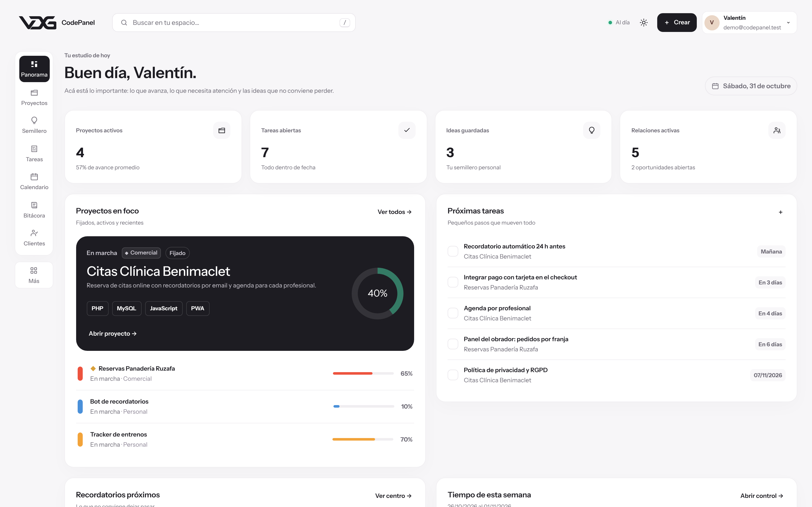
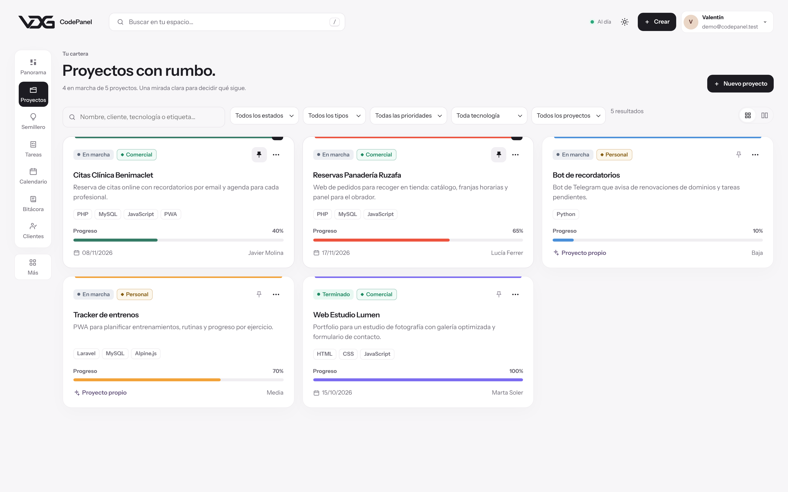
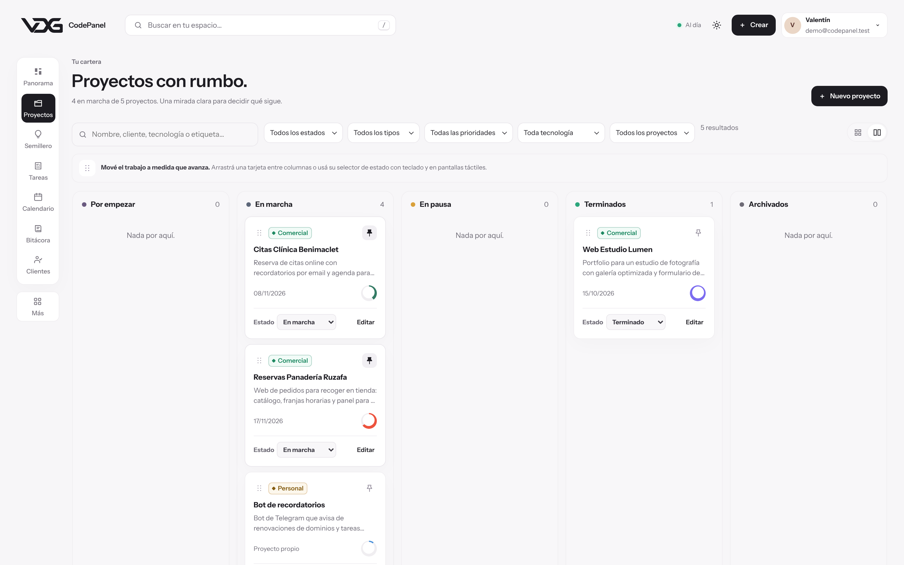
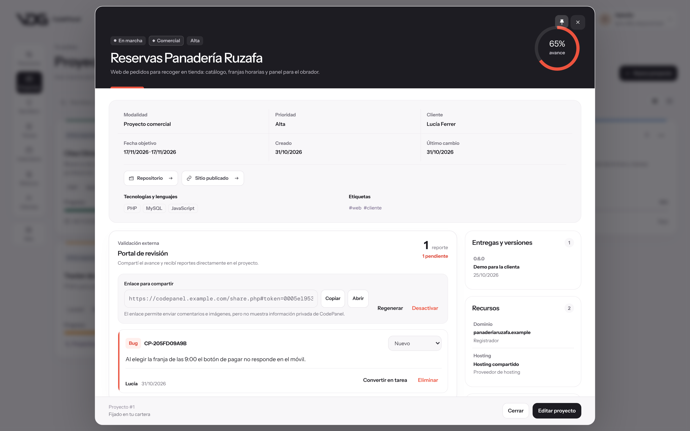
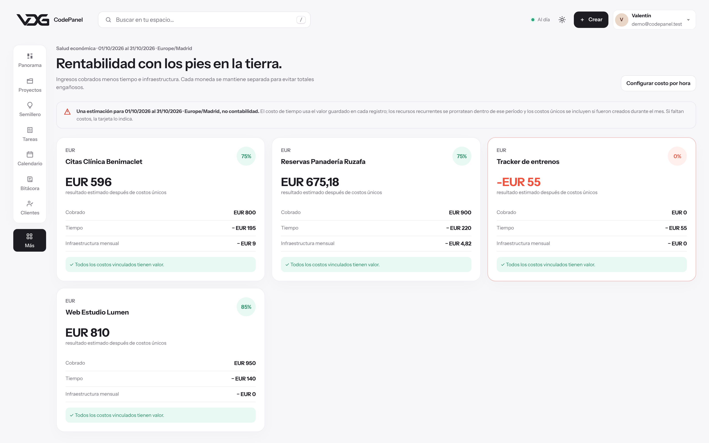
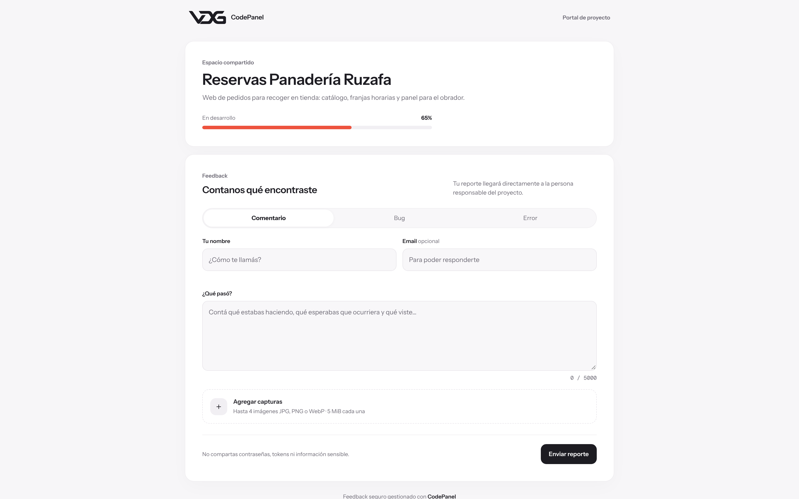
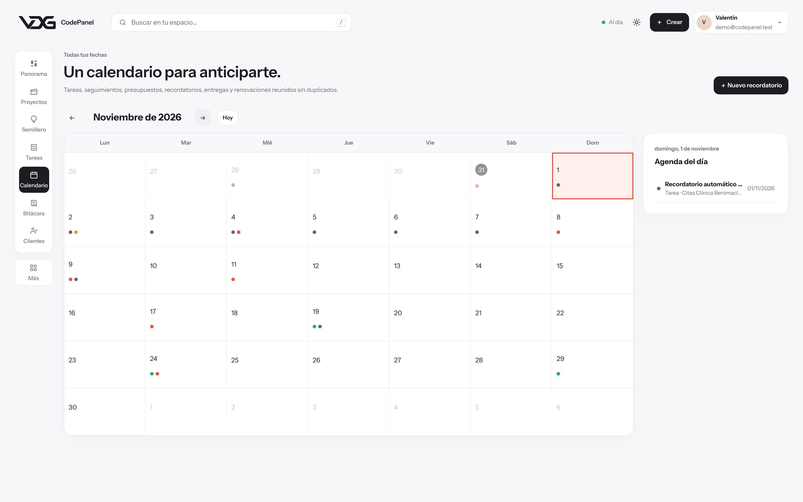
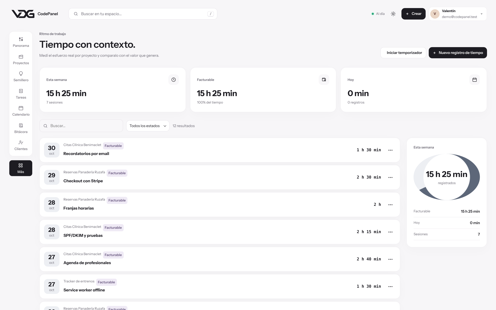
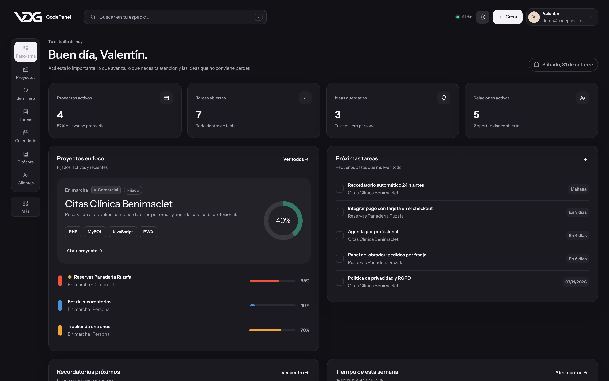

<div align="center">

# CodePanel

**Espacio de trabajo para programadores: proyectos, clientes, tiempo y rentabilidad en una sola aplicación.**

PHP 8 · MySQL · JavaScript nativo · API JSON propia · PWA



<sub>Todas las capturas usan datos ficticios.</sub>

</div>

---

## El problema

Cuando trabajas en varios proyectos a la vez, la información se dispersa: las ideas en un bloc de notas, los presupuestos en un Excel, los dominios y servidores en la memoria y las horas invertidas en ningún sitio. Al final no sabes qué proyecto te está dando dinero y cuál te lo está quitando.

CodePanel reúne todo eso alrededor de cada proyecto: tareas, bitácora de decisiones, presupuestos y cobros, entregas, infraestructura con sus renovaciones y el tiempo dedicado. Está **en producción, con usuarios reales**, y lo uso a diario para gestionar mis propios proyectos.

## Capturas

| Proyectos | Kanban |
|---|---|
|  |  |

| Ficha de un proyecto | Rentabilidad por proyecto |
|---|---|
|  |  |

| Portal para el cliente | Calendario unificado |
|---|---|
|  |  |

| Control de tiempo | Tema oscuro |
|---|---|
|  |  |

## Qué incluye

- **Panel personalizable** con lo que necesita atención: proyectos activos, próximas tareas, recordatorios, tiempo de la semana y finanzas.
- **Proyectos personales o comerciales.** Un proyecto personal no arrastra cliente ni fecha de entrega; uno comercial se conecta con presupuestos, cobros y entregas. Vista de tarjetas y **Kanban** con arrastrar y soltar, filtros y proyectos fijados.
- **Ficha de proyecto** que reúne tareas, galería, línea de tiempo construida desde la bitácora, entregas, recursos y presupuestos.
- **Portal público para el cliente:** un enlace de solo lectura desde el que puede ver el avance y reportar errores con hasta cuatro capturas. Los reportes llegan al panel con su estado.
- **Bitácora de desarrollo** con decisiones, avances, bloqueos y aprendizajes.
- **Presupuestos y cobros**, **entregas y versiones**, **recursos e infraestructura** con coste y fecha de renovación.
- **Control de tiempo** manual o con cronómetro (uno activo por usuario).
- **Rentabilidad** por proyecto: ingresos menos horas e infraestructura.
- **Calendario unificado**, semillero de ideas, clientes y oportunidades, revisión semanal, etiquetas y archivos adjuntos.
- **PWA instalable**, tema claro y oscuro, diseño adaptado a móvil.

## Decisiones técnicas

**Rentabilidad multimoneda sin inventar tipos de cambio.** Un proyecto cobrado en euros con infraestructura pagada en pesos no se puede sumar sin una tasa de conversión, y cualquier tasa que elija el software estará desactualizada. La decisión fue no convertir nunca: la rentabilidad se devuelve agrupada por moneda. Es menos vistoso que un número único, pero es el único resultado que no es falso.

**Abrir el proyecto al cliente sin abrirle la aplicación.** Darle una cuenta era darle acceso a presupuestos, tiempos y otros proyectos. El portal (`share.php`) es una página separada que solo conoce un proyecto a través de un token de 64 caracteres, no comparte sesión con el panel y guarda las capturas fuera del alcance web. Si el enlace se filtra, se regenera y el anterior deja de funcionar.

**Adjuntos seguros en un hosting compartido.** Sin control sobre la configuración del servidor, la defensa es en capas: nombre de fichero aleatorio, directorio fuera del alcance web con doble bloqueo, verificación del tipo real con `fileinfo` en lugar de la extensión, lista blanca de formatos y descarga solo por una ruta que valida sesión y propiedad.

**Sin proceso de compilación.** Ni Composer ni npm: la aplicación tiene que poder subirse por FTP a un hosting compartido y funcionar. La interfaz es HTML y JavaScript nativo que consume la API JSON propia.

**Un instalador honesto.** `database/schema.sql` borra antes de crear, lo correcto para instalar y peligroso para actualizar. Por eso las actualizaciones van por migraciones numeradas y no destructivas.

## Arquitectura

```
CodePanel/
├── index.php            # interfaz (SPA en JavaScript nativo)
├── share.php            # portal público del proyecto
├── service-worker.js    # PWA: shell offline y caché
├── api/                 # punto de entrada de la API JSON
├── app/                 # lógica de negocio, no accesible por web
├── database/
│   ├── schema.sql       # instalación inicial (22 tablas)
│   └── migrations/      # migraciones no destructivas
├── storage/             # adjuntos y capturas, nunca públicos
├── assets/              # CSS, JavaScript, fuentes e iconos
├── scripts/verify.sh    # revisa configuración, extensiones y lint
└── tests/               # regresión del backend, PWA y pruebas por HTTP
```

La API sigue un mismo contrato REST para 14 recursos, con rutas específicas para lo que no encaja en un CRUD: cronómetro, calendario combinado, rentabilidad, adjuntos y portal público.

## Seguridad

- Token CSRF obligatorio en toda operación que modifica datos, incluidos el acceso y el registro.
- Límite de intentos de acceso guardado en base de datos: 5 fallos por correo y 20 por IP cada 15 minutos.
- Registro cerrado por defecto: solo se abre para crear la primera cuenta.
- Reglas `.htaccess` que bloquean la configuración, `app/`, `database/` y el almacenamiento privado.
- Cuotas de subida por archivo y por usuario, y límite de envíos en el portal público.
- Sesiones con cookie segura bajo HTTPS y modo demo apagado por defecto en producción.

## Probarlo en local

Requisitos: PHP 8.1+ con `pdo_mysql`, `mbstring` y `fileinfo`, y MySQL 8 o MariaDB 10.5+.

```bash
cp .env.example .env              # completa la conexión a MySQL
mysql -u root -e "CREATE DATABASE codepanel CHARACTER SET utf8mb4"
mysql -u root codepanel < database/schema.sql
php -S localhost:8080             # abre http://localhost:8080 y crea tu cuenta
```

Para verla sin base de datos, con datos de ejemplo, define `DEMO_FALLBACK=true` en `.env`.

```bash
bash scripts/verify.sh            # comprueba configuración, extensiones y sintaxis
php tests/backend_regression.php  # regresión del backend (crea y borra una base temporal)
php tests/pwa_contract.php        # manifiesto, iconos y caché offline de la PWA
```

Las pruebas del backend usan una base de datos temporal, así que el usuario de MySQL necesita permiso para crearla.

## Autor

Diseñado y desarrollado por **Valentín De Gennaro**: modelo de datos, API, interfaz, sistema de adjuntos, cálculo de rentabilidad, portal para clientes, PWA y scripts de verificación.

[Portafolio](https://portafolio.valentindg.com) · [LinkedIn](https://www.linkedin.com/in/valentindg/) · [valentindg.com](https://valentindg.com)

## Licencia

El código es público para que se pueda leer y evaluar, pero no es software libre: todos los derechos están reservados (consulta [LICENSE](LICENSE)). Si quieres usarlo o adaptarlo, escríbeme.
